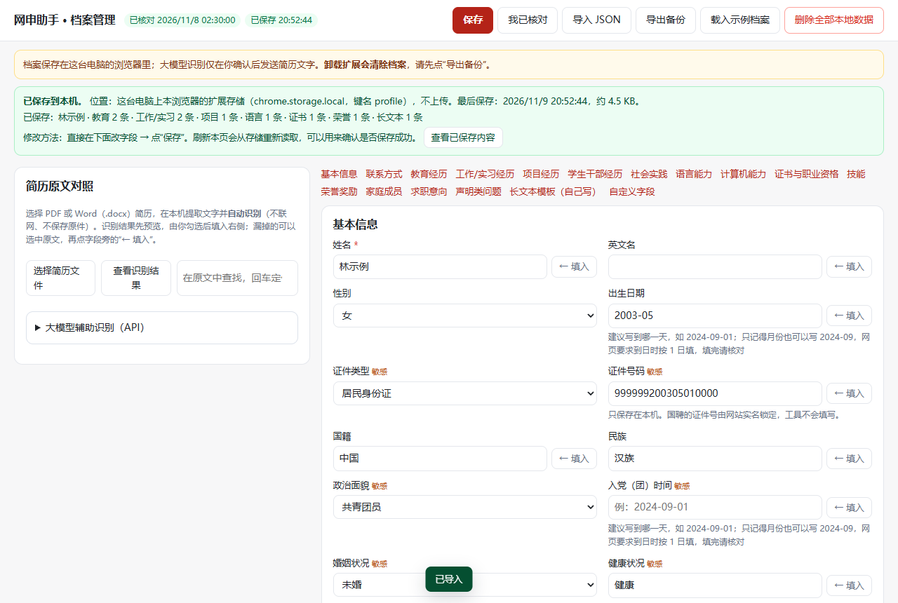
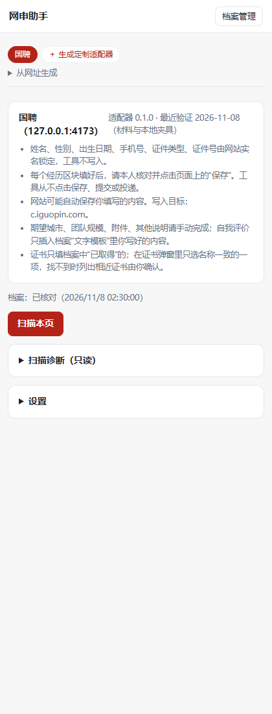
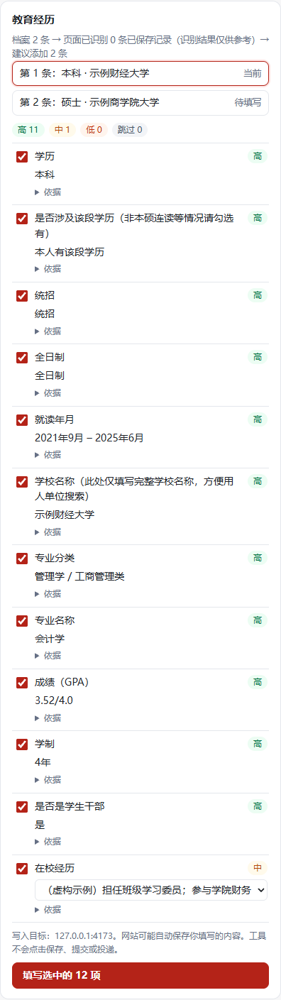
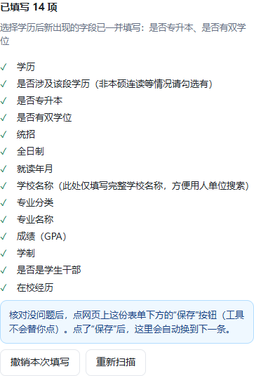

# 使用手册

网申助手做两件事：

1. 把你的简历资料整理成一份**本地档案**，只存在这台电脑的浏览器里。
2. 在招聘网站的简历/申请表页面上，**先给你看要填什么，你确认后再填**。保存、提交和投递都由你自己点。

| 你在哪个网站 | 看哪一节 |
|---|---|
| 国聘“申请简历”页 | 第二节 |
| 智联校园网申“填写简历”页 | 第三节 |
| 其他网站（企业招聘官网、“我的简历”简历中心、智联社招等） | 第四节 |

每次用的顺序都一样：**打开网页 → 扫描本页 → 看预览、勾选 → 填写 → 在网页上核对 → 你自己点保存**。工具填的内容不保证全对，保存前请看一遍。

---

## 一、建档案（只做一次，之后按需修改）

点工具栏上的网申助手图标 → 侧边栏右上角 **“档案管理”**。

### 1. 录入

- 右侧按栏目录入：基本信息、联系方式、教育经历、工作/实习、语言、证书、求职意向等。
- **教育经历每段一条**：本科、硕士要分成两条；工作、实习也是一段一条。用“＋ 添加一条”新增，↑↓ 调整顺序。
- **日期尽量写到日**（如 `2024-09-01`）：不少网站要求选到哪一天。只知道年月也可以写 `2024-09`，网页要求到日时工具会先按 1 日填上，你可以在侧边栏改。还在读、还在职，就勾选“至今”。
- **容易混淆的字段是分开的**：籍贯 ≠ 生源地，户口所在地 ≠ 现居住地，学历 ≠ 学位。
- 自我评价、在校经历、工作内容这类长文字，**由你自己写好**。工具只会原样插入，不会帮你写，也不会改写。
- 标着“敏感”的字段（政治面貌、婚姻、户口、紧急联系人、家庭成员等），只在网站字段**完全确定**时才会使用。

### 2. 从简历自动识别（推荐）

左侧 **“简历原文对照”** → **“选择简历文件”**，选你的 PDF 或 Word（.docx）简历：

1. 工具在本机提取文字，并**自动识别**姓名、联系方式、教育经历、实习/工作、项目、校园经历、获奖、证书、技能、自我评价等，弹出 **“从简历中识别到的内容”**。
2. 逐项看一遍，勾选要填入的。以下几类**默认不勾选**：
   - 高敏感信息（手机号、政治面貌、户口等），确认无误后自己勾上；
   - 档案里已经有值的字段（显示“档案已有：…”），除非勾选“覆盖档案中已有的值”；
   - 档案里已有的同一段经历（同学校同入学时间、同单位同开始时间），不会重复添加。
3. 点 **“填入选中的 N 项”**。填进来的字段和经历会有**黄色底**，提醒你核对；带“推断”字样的（如“工作性质按‘全职’推断”）尤其要看。
4. 识别不出或识别错的，可以在左侧原文中选中文字，点右侧字段旁的 **“← 填入”** 手动修正；之后还可以点 **“查看识别结果”** 再打开一次。
5. **最后一定要点“保存”**。识别结果只填到页面上，没保存前不会存进档案，侧边栏也读不到。

默认识别在本机按规则完成，不联网、不保存简历原件；也可选择大模型 API 识别。证件号**永远不会**被识别填入。支持常见的单栏和“左侧信息栏 + 右侧经历栏”两栏版式；扫描版（图片）PDF 提取不出文字，只能手动录入。老的 `.doc` 文件请先在 Word 里“另存为 .docx”。

### 3. 保存、确认保存位置、修改

- 点 **“保存”**（或按 Ctrl+S）。保存时会把内容读回来核对一遍；如果有格式问题，页面顶部会列出是哪一栏哪一项。
- 保存成功后，页面上方的绿色条会写明：**保存位置**（这台电脑上本浏览器的扩展存储 `chrome.storage.local`，键名 `profile`）、最后保存时间、大小，以及各栏条数（如“教育 2 条 · 工作/实习 2 条”）。
- 点 **“查看已保存内容”** 可以直接看存储里的原始数据（只读），用来确认确实存进去了。**刷新档案页**后内容还在，也说明保存成功。
- **修改**：直接在页面上改字段 → 再点“保存”。改到一半想放弃，点 **“放弃修改，恢复到已保存”**。
- 全部检查一遍后，点 **“我已核对”**。以后**每次修改档案都需要重新核对**；没核对过的档案，侧边栏会给出提醒。

### 4. 备份

点 **“导出备份”** 得到一个 `.json` 文件。这个文件是明文，含有你的个人信息，请只存在自己的电脑或 U 盘里。换电脑或重装扩展后，用 **“导入 JSON”** 恢复。

> 在扩展管理页“移除”扩展会清空档案，请先导出备份。备份文件里有档案、定制适配器（第四节）和设置，不含大模型 API 密钥。

---

## 二、在国聘上填写

### 1. 打开页面

自己登录国聘，进入 **“申请简历”** 页面。姓名、性别、出生日期、手机号、证件号是网站实名锁定的，工具不碰。

### 2. 打开侧边栏并扫描

点工具栏上的网申助手图标，浏览器右侧会打开侧边栏。点 **“扫描本页”**。

第一次使用时，侧边栏可能显示 **“读取不到当前网页的地址”**：点 **“允许读取当前网页地址”**，在浏览器弹窗里点允许（只问一次）。之后侧边栏顶部会显示“国聘（…iguopin.com）”。

第一次在国聘上扫描时，浏览器会问“是否允许读取和更改 iguopin.com 上的数据”，点 **允许**。只有你点扫描时，扩展才会读取页面。

### 3. 逐个区块处理

侧边栏按页面上的区块列出：

| 区块 | 怎么做 |
|---|---|
| 基本信息、求职意向 | 点“展开编辑表单并扫描”，工具会点开网站上的“编辑”，然后显示预览 |
| 教育经历、工作/实习、英语能力 | 侧边栏列出档案里的每一条，以及页面上是否已经有了。点“添加并准备第 N 条”，工具会点开网站上的“添加”，然后显示这一条的预览 |
| 项目经历、荣誉奖励 | 同上，按档案逐条“添加并准备” |
| 自我评价 | 点“展开编辑表单并扫描”。只插入你在档案“文字模板”里写好的自我评价（类型选“自我评价”），有多段时让你选一段；工具不生成文字 |
| 证书信息 | 按档案逐条“添加并准备”。工具打开证书弹窗，按名称（含常见别名，如“初级会计专业技术资格”=“初级会计职称”）找到**名称一致且唯一**的一项才选；只找到相近的会列出“改选 …”按钮由你确认。档案里“部分通过”“在考”的证书默认不填 |
| 附件、其他说明 | 需要你手动完成 |

点侧边栏里某个区块的**标题**，网页会滚到那个区块；你在网页上滚动时，侧边栏也会跟着停到对应区块（你正在操作侧边栏时不打扰，可在侧边栏底部“设置”里关闭）。点“添加并准备”“填写选中的项”后，侧边栏停在原来的位置，不会跳回顶部。

### 4. 看预览，勾选，填写

每一行是页面上的一个字段，后面标着把握程度：

| 标记 | 意思 | 默认 |
|---|---|---|
| **高** | 字段和取值都确定 | 已勾选 |
| **中** | 大致对得上：有几个相近的选项、日期只到月、推断出来的值 | 已勾选，先选最接近的一项（日期按 1 日补齐），旁边写明原因，可以改或取消勾选。自我评价这类有多段文字可选的，要你自己挑一段 |
| **低** | 认不出这个字段，或没把握 | 不填，页面上用橙色框标出 |
| **跳过** | 网站锁定、页面已有内容、需要你本人完成、档案里没有 | 不填，写明原因 |

政治面貌、婚姻、户口等敏感项对不准时不会按“中”处理，而是直接跳过。

点每行的“依据”可以看到为什么这样判断（例如“网页的‘入学时间’对应档案里的‘教育经历 › 入学时间’”）。确认后点 **“填写选中的 N 项”**。填写时，页面上正在处理的字段会有蓝色框。

### 5. 看结果，自己保存

- 结果列出每一项是否成功。没填上的都会写明原因，例如“选项中没有对应项”“需要本人完成”。
- 如果某个下拉框有好几个相近的选项，结果里会列出页面上的候选，点“改选”就能选其中一个。
- **请在页面上核对这一条，然后由你点击页面上的“保存”。** 工具任何时候都不会点击保存、提交或投递。
- 对填写结果不满意，可以点 **“撤销本次填写”**。已经被你改过的字段会保留你的修改，不会被撤销。已经保存到网站上的记录，工具不会删除，需要你在页面上手动删。

经历区块保存后，侧边栏会自动进入下一条。档案里的记录都已经在页面上时，会显示“档案中的记录都已在页面中”。

### 存回档案（页面上补填的内容）

档案里没有、你在网页上手动补填的内容（例如“单位性质”“补充说明”），可以存回档案，下次自动填写：

1. 你在网页上点 **“保存”**，网站接受保存（表单收起）后，侧边栏会弹出 **“把…里的内容存回档案？”**。
2. 清单里标明每一项是 **补上**（档案里为空，默认勾选）、**与档案不同**（默认不勾选，以免覆盖）、**新建记录**（档案里没有这一条经历时整条新建；缺必填项时不能新建）、**新建自定义项**（档案里没有对应栏目的字段）或 **新增文字模板**（自我评价）。
3. 只写入你勾选的项，只存在本机。点“这次不用”则什么都不改。不想每次被问，可勾选“以后不再自动询问”，或在侧边栏底部“设置”里开关。

工具读取的是你点保存那一刻页面上显示的内容；网站校验没通过（表单没收起）时不会询问。

### 6. 全部完成后

在页面上整体检查一遍，**由你决定是否提交或投递**。

---

## 三、在智联校园网申上填写（专用适配）

网址形如 `xiaoyuan.zhaopin.com/scrd/resume2?...`（智联校园的“填写简历”页）。侧边栏顶部会显示“智联校园”。

1. 这个页面**一次只显示一个区块**（右侧导航：个人信息、教育经历、求职意向……）。在网页上切到哪个区块，就在侧边栏点 **“扫描本页”/“重新扫描本页”**。
2. 区块默认是只读展示（值显示为 `--`）。
   - **个人信息、求职意向、其他信息**：点 **“展开编辑表单并扫描”**，工具会点网页上的“编辑”。
   - **教育经历、实习/工作经历、语言能力、奖励荣誉**：点 **“添加并准备第 N 条”**，工具会点标题栏的“添加”，按档案逐条填写（教育按学历从高到低，实习按时间从近到远）。
3. 看预览、勾选、点 **“填写选中的 N 项”**。日期框不能键入，工具会在日期面板上逐级点选年、月、日。
4. 核对后**由你点网页上的“保 存”**（单项区块）或表单里的 **“添 加”**（新记录）。工具从不点这两个按钮。保存后侧边栏会询问是否把页面上补填的内容存回档案，并转到下一条。

网站自带的弹窗也会自动处理：
- **城市**（现居住城市、入学前户口所在地、高考生源地、期望城市）：按 省 → 市 → 区县 点选，直辖市在“热门”里；期望城市可多选，选完点弹窗的“确定”。页面要求选到区县而档案只到市时，会说明原因，请在页面上补选。
- **离职时间“至今”**：点日期面板左侧的“至今”。
- **专业技能**：技能类型在弹窗里按名称查找（档案写“Excel（数据透视表）”也能找到“Excel”）；“其他技能”这类没有下一级的分类不会被误选。
- **语言证书**：选了语种后出现证书栏，在“考试 → 级别”弹窗里按名称查找。

档案里新增了几项，在档案管理页填写后就能用：教育经历的“海外学习年限”、实习的“税前月薪”“是否有证明人”、语言的“听说能力”“读写能力”、技能熟练程度新增“良好”。证件号码类型只选“身份证”等类型，证件号码仍由你本人填写。

需要你手动处理的：附件（证件照、简历附件）、期望工作性质（多选勾选）。

- **体重**：档案没有固定字段。在档案管理的“自定义字段”里加一项，标签写“体重(kg)”或“体重”，值写数字。
- **年级排名**：档案写“15/180”或“前 8%”时，会换算成“前10%”这类档位，作为“中”先选上，请核对。
- **日期只记到月**：网页要求选到哪一天、档案里只写到月（如 2024-09）时，先按 1 日填（2024-09-01），侧边栏可以改成具体日期；建议在档案里直接写到日。
- **薪资**：档案月薪 8000、12000 会对应网站的“8千”“1.2万”。

---

## 四、在其他网站上（通用识别 / 定制适配器）

在智联招聘、企业自己的招聘官网（北森、大易、Moka、各企业招聘平台）上，直接用**通用识别**：点 **“扫描本页”**，侧边栏按区块列出每个字段对应档案里的哪一项、把握程度。和国聘一样：“高”和“中”都默认勾选（“中”是大致对得上，先选最接近的一项，可在侧边栏改），核对后点 **“填写选中的 N 项”**。工具只填写，不点保存、提交或投递。

### “我的简历”简历中心（先预填、再统一投递）

不少企业（例如山东高速招聘平台）是在“个人中心 → 我的简历”里分成**基本信息、教育背景、家庭情况、工作履历……**几个子页面先填好，之后申请职位时直接投递这份简历。用法：

1. 打开第一个子页面（如“基本信息”）→ 扫描本页 → 核对 → 填写选中的项 → **你自己点页面上的“保存”**。
2. 点左侧导航进入下一个子页面（如“教育背景”），**再点一次“扫描本页”**（换页后之前的扫描结果会清空）。
3. 经历类子页面：侧边栏列出档案里的每一条（已经在页面上的会标“页面中已存在”）。点 **“添加并准备第 1 条”**，插件替你点开网站的“添加”弹窗并按这一条预填；核对后**你点弹窗里的“保存”**，侧边栏会自动转到第 2 条。想换一条，点列表里的那一条即可。
4. “家庭情况”“附件上传”等区块显示“需本人完成”，插件不填写。
5. 全部子页面都保存后，再去职位页面投递。

### 生成定制适配器（让这个网站也能自动填写）

1. 打开该网站的申请表页面（需要登录的先登录），把要填写的各区块的“添加/编辑”都点开。也可以在侧边栏顶部展开“从网址生成”，粘贴网址后在新标签页打开。
2. 点侧边栏顶部的 **“＋ 生成定制适配器”**。插件读取页面上的**表单结构**（区块标题、字段名称、控件类型、选项），弹窗里可以“查看将要发送的内容”——**不含你的档案，也不含页面上已填写的内容**。
3. 填好大模型 API（地址、模型名、密钥；与档案页“大模型辅助识别”共用设置，密钥只保存到浏览器关闭），点 **“确认发送并生成”**。大模型只能从固定的档案路径白名单里选，不合规的输出会被丢弃并列出。
4. 在 **复核** 窗口里逐项核对：每个区块对应哪个档案栏目、每个字段对应档案里的哪一项（“自动识别”= 交给通用规则；“需本人完成”= 不填）。给适配器**起个名字**，点“保存适配器”。
   - **档案里没有的网站字段**（如曾用名、档案所在地、档案是否转移、兴趣爱好、应聘人员类型）：在下拉框里选 **“＋ 新建自定义字段”**，填上你的值（如“否”“社会招聘”）。保存适配器时这些字段会写进档案的“自定义字段”，之后扫描按它填写（“高”，默认勾选）；下拉/单选要求值与网页选项完全一致。
   - 档案里已有的自定义字段也会出现在下拉框里（“自定义·曾用名”），生成时大模型也能选它们——**只发送自定义字段的名称，不发送值**。
   - 已经保存过的适配器，点侧边栏顶部的 **“编辑对应关系”** 就能补选或新建，不用重新生成。
5. 保存后，适配器显示在侧边栏顶部（红色为当前使用的）。之后打开这个网站会自动使用它。点 **扫描本页** → 各区块出现预览 → 勾选 → **填写选中的项**。重复区块（教育、工作…）一次填当前展开的一份表单，点上面列出的某一条可以改用那一条。
6. 侧边栏顶部可以随时 **编辑对应关系**、**重命名**、**删除**；也可以点其他芯片切换适配器（例如切回“通用识别”）。

定制适配器同样只填写、不点保存或提交；需要点“添加”才出现的表单请先在网页上点开再扫描。

- 第一次在某个网站上用时，侧边栏如果显示 **“读取不到当前网页的地址”**，点 **“允许读取当前网页地址”**（浏览器限制，只需授权一次）；之后点“扫描本页”，浏览器会问是否允许访问该网站，点允许。
- 能识别：原生表单，以及 Element UI / iView / Arco / antd 等常见组件库做的表单；网站用普通文字（不是标题标签）写的区块名，如“教育经历”“工作经历”；同一网站内嵌的表单框架。能**填写**的组件库：原生表单、antd、Element UI（1.x / 2.x）；其他组件库的文本框能填，下拉和日期可能需要手选。
- 区块只显示文字（如“姓名：--”）、要点“编辑”才出现输入框时：侧边栏这个区块会有 **“点网页上的‘编辑’并扫描”**，工具点开后显示预览。经历类区块点 **“添加并准备”**。已保存的经历记录旁的“编辑”（修改已有记录）工具不会点，需要改时自己点开再扫描。
- 表单放在**其他网站的内嵌框架**里时（不少企业招聘系统这样做），浏览器不允许读取，侧边栏会提示；可以试试在新标签页单独打开那个表单页面再扫描。
- 在国聘网站上，如果当前页面不是“申请简历”页（或网站改版导致专用适配器认不出区块），侧边栏会自动改用通用识别，并写明原因。

---

## 五、扫描诊断（帮开发者改进）

国聘页面上有一些细节还需要在真实页面上确认，比如政治面貌的选项、日期面板、学校搜索结果、已保存记录的样子。你可以生成一份**不含任何个人信息**的结构报告，帮开发者修正这些细节：

1. 在国聘申请简历页上，把基本信息、教育经历、工作经历、英语能力、求职意向的“编辑/添加”都点开（**不用填写**）。
2. 在侧边栏最下面展开 **“扫描诊断（只读）”**，点“生成诊断报告”。
3. 报告里只有字段名、控件类型、选项文字和面板结构。**请先自己从头到尾看一遍**，确认没有你的姓名、电话、学校、证件号等内容。
4. 点“下载报告文件”，把文件发给开发者。

---

## 常见问题

**侧边栏提示“页面没有响应”** —— 刷新页面后再点“扫描本页”。

**提示“页面已刷新或跳转：之前的撤销记录已失效”** —— 页面刷新后，工具无法再对应之前的修改，所以撤销失效。这是为了避免撤销错地方。

**某个字段总是“选项中没有对应项”** —— 说明网站的选项写法和档案里的不一样，请手动选。也可以在诊断报告里带上这个字段，交给开发者补充别名。

**网页要求日期选到某一天，档案里只写到月份** —— 工具先按当月 1 日填，并在预览里标“中”写明原因。请在预览里改成具体日期，或填完后在页面上改；建议直接把档案里的日期写到日。

**换了新版本后，档案、定制适配器不见了** —— 两种情况会这样：在扩展管理页点过“移除”；或者是从 0.8.1 及更早版本升到 0.9.0（只有这一次）。用“导入 JSON”把备份导回来即可，0.9.0 起的备份里带着定制适配器（见[安装说明](安装说明.md)“升级到新版本”）。

**侧边栏顶部看不到“国聘”或“智联校园”** —— 这两个内置适配器只在对应网站的页面上才显示；在别的网站上，顶部显示的是“通用识别”和你保存过的定制适配器。

## 大模型辅助识别

1. 在档案页选择 PDF / DOCX 后，关闭本地识别预览，展开“大模型辅助识别（API）”。
2. 填写 API 地址、模型名称和密钥。地址可为 Base URL（例如服务商文档中的 `/v1` 地址）或完整 `/chat/completions` 地址。远程地址须使用 HTTPS；本机服务支持 HTTP。
3. 点“大模型识别”，核对将发送的全文和服务商地址，点“确认发送并识别”。服务商按其规则处理文字及计费。
4. 核对每条经历的字段和原文依据。已有经历可勾选补齐空白；只有同时勾选“覆盖档案中已有的值”才覆盖冲突内容。
5. 点“填入选中的项”，再保存、核对档案。网站填写仍通过侧栏扫描、预览和本人确认。

密钥仅保留在本次浏览器会话，重启浏览器后需重新输入；“清除密钥”立即移除它。取消、超时、接口报错、无效 JSON 或错误字段不会修改档案。API 不会从没有写项目经历的简历中创造项目。扫描 PDF 的 OCR 暂未支持。

## 切换标签页

同一窗口中切走再切回，保留该页面的扫描结果、选中项、当前经历和填写反馈。填写正在进行时，先完成当前操作，再切换侧栏显示，避免写到其他标签页。页面刷新或跳转后重新扫描；修改档案后也须重新扫描。关闭侧栏或重启浏览器不保留这份临时进度。

接口与权限依据：
- Chrome 扩展跨域请求：https://developer.chrome.com/docs/extensions/develop/concepts/network-requests
- JSON 输出接口示例：https://api-docs.deepseek.com/guides/json_mode/

兼容接口不代表所有模型都支持 JSON 输出；请使用服务商文档中支持该参数的模型。
