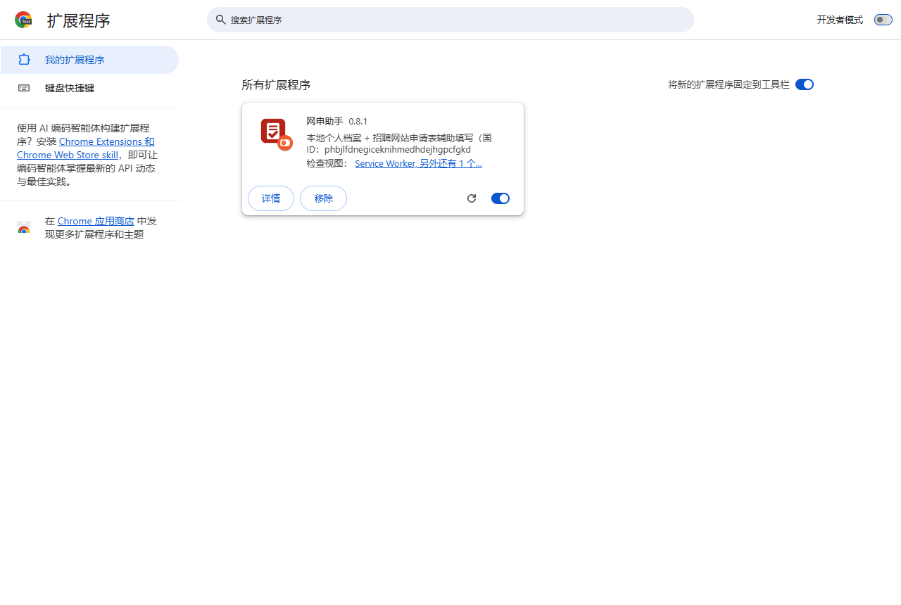

# 安装说明（Chrome / Edge）

适用：Chrome 116 及以上，或 Edge（新版，基于 Chromium）。整个过程大约 3 分钟，只需要做一次。

## 第 1 步：解压安装包

1. 拿到安装包（文件名形如 `resume-copilot-v0.9.0.zip`，数字是版本号）后，右键 →“全部解压缩”。
2. 把解压出来的文件夹放到一个**不会被删除、以后也不改名的位置**，例如 `D:\网申助手`。
   浏览器每次启动都会从这个文件夹读取扩展，文件夹被删掉或移动后扩展就不能用了。以后升级也用这同一个文件夹（见下面“升级到新版本”）。

## 第 2 步：打开扩展管理页并开启“开发者模式”

- **Chrome**：在地址栏输入 `chrome://extensions` 回车。
- **Edge**：在地址栏输入 `edge://extensions` 回车。

打开右上角（Edge 在左侧）的 **“开发者模式”** 开关。

## 第 3 步：加载扩展

1. 点击 **“加载已解压的扩展程序”**（Chrome 中文界面里也可能显示为“加载未打包的扩展程序”）。
2. 选择第 1 步解压出来的文件夹（里面能直接看到 `manifest.json` 文件的那一层），点“选择文件夹”。
3. 列表里出现 **“网申助手”** 卡片，就说明装好了。

> 浏览器启动时可能提示“请停用开发者模式下的扩展”，点 **“保留”/“取消”** 即可，不要点“停用”。这是所有手动安装的扩展都会出现的提示。

## 第 4 步：固定到工具栏

点击浏览器右上角的拼图图标 🧩，找到“网申助手”，点旁边的图钉。之后工具栏上会一直显示红色的网申助手图标。

## 第 5 步：第一次使用

第一次安装后会自动打开 **档案管理页**。下一步请看 [使用手册](使用手册.md) 的“建档案”部分。

## 升级到新版本

1. 先在档案管理页点 **“导出备份”**，留一份档案文件（以防万一）。
2. 把新版本解压，把里面的文件**覆盖到原来的文件夹**（就是第 1 步放扩展的那个文件夹，提示“替换文件”时选“全部替换”）。
3. 打开扩展管理页，在“网申助手”卡片上点刷新按钮 ⟳。
4. 已经打开着的招聘网站页面请**刷新一次**，侧边栏也关掉重开一次。

> **升级时不要点“移除”。** 档案、定制适配器和设置都存在浏览器里，覆盖文件夹再点刷新，它们都还在；一旦在扩展管理页点了“移除”，这些数据会被一起删掉。
>
> 万一数据没了：打开档案管理页，用 **“导入 JSON”** 把备份文件导回来。0.9.0 起的备份文件包含档案、定制适配器和设置；更早版本的备份只有档案。
>
> **从 0.8.1 或更早版本升级到 0.9.0（只需这一次）：** 0.9.0 给扩展固定了身份标识，浏览器会把它当成一个新扩展，旧版本里的数据不会自动带过来。请先在旧版本里“导出备份”，装好 0.9.0 后“导入 JSON”，确认档案都在，再移除旧版本。旧版本里的定制适配器需要重新生成。

## 卸载

在档案管理页点 **“导出备份”** 保存一份档案文件，然后在扩展管理页点“移除”。移除后浏览器里保存的档案、定制适配器和设置都会被清除。
